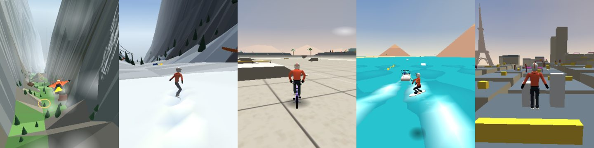

<h1 align="center">Ligne Libre</h1>

<p align="center">
  <strong>A 3D extreme sports arcade game that runs in the browser.</strong><br>
  Seven sports, seven locations, one HTML file. No install, no account.
</p>

<p align="center">
  <a href="https://azert-maker.github.io/lignelibre.github/"><strong>▶ Play now</strong></a>
  ·
  <a href="#getting-started">Run locally</a>
  ·
  <a href="https://github.com/azert-maker/lignelibre.github/issues/new/choose">Report a bug or suggest an idea</a>
</p>

<p align="center">
  <a href="https://github.com/azert-maker/lignelibre.github/actions/workflows/ci.yml"></a>
  <a href="https://github.com/azert-maker/lignelibre.github/actions/workflows/pages.yml"></a>
  <a href="LICENSE"></a>
  <a href="https://threejs.org/"></a>
</p>

<p align="center">
  
</p>

## Contents

- [Overview](#overview)
- [Features](#features)
- [Sports and locations](#sports-and-locations)
- [Controls](#controls)
- [Getting started](#getting-started)
- [How it works](#how-it-works)
- [Project structure](#project-structure)
- [Quality and testing](#quality-and-testing)
- [Deployment](#deployment)
- [Security](#security)
- [Status and roadmap](#status-and-roadmap)
- [Contributing](#contributing)
- [License and credits](#license-and-credits)

## Overview

Ligne Libre is an arcade sports game built with [Three.js](https://threejs.org/). Pick a sport, press **Play**, and you are riding within a second: the last sport and mode you chose are remembered, and every option beyond that is optional.

Each sport has its own physics and its own skill: aerial lines in the wingsuit, cornering speed on the longboard, rotations on the snowboard, tricks and balance on the BMX, landings on the motocross bike, pop on the wakeboard, flow on the rooftops.

The whole game is assembled into **a single self-contained HTML file** (code, sounds and 3D models embedded), which makes it trivial to host, share or play offline after the first load.

The game interface is in French.

## Features

- **7 sports**, each with a free mode and a timed course mode with medals.
- **7 locations** with their own sky, light and landmarks (waterfalls, snowpark, palm-lined beach, red desert rocks, Eiffel Tower silhouette...).
- **Arcade scoring**: tricks, combos up to ×4, overdrive, graded landings (perfect / clean / sketchy) and physical crashes.
- **Collectible coins** in every sport: gold coins on the main line, larger ringed bonus coins (worth 2) on risky lines.
- **Progression**: levels per sport, trick challenges, daily challenge and daily course, streaks.
- **Shop and skin machine**: gear that changes physics is bought directly; the animated skin machine only gives cosmetics, with published odds and a pity counter. No real money anywhere.
- **Replay, ghost of your best run** and clip export.
- **3D models made in Blender** (rider with a 19-bone rig, BMX, motocross bike) with a procedural fallback if a model fails to load.
- **Local multiplayer** (2–4 players on the same network) through a small WebSocket server.
- **Desktop and mobile**: keyboard, touch controls, quality presets.
- **Saves stay in the browser**, with profile export and import.

## Sports and locations

| Sport | Location | What you master |
|---|---|---|
| Wingsuit | Lauterbrunnen Valley | gliding lines, proximity flying, rings |
| Downhill longboard | Mount Tamalpais | speed, racing lines, slides |
| Snowboard | Whistler Blackcomb | kickers, rails, spins and flips |
| BMX | Venice Beach Park | airs, tailwhips, barspins, grinds, manuals |
| Motocross | Glen Helen MX | tables, whoops, whips, landings |
| Wakeboard | Lake Havasu | edging, pop, wake to wake |
| Parkour | Paris Rooftops | gaps, vaults, wall runs, flow |

Location names set the mood of each map; there is no affiliation with these places or their operators.

## Controls

Every sport shows its own controls on screen and in the pause menu. Shared keys:

| Key | Action |
|---|---|
| Arrow keys | steer, lean, speed (meaning depends on the sport) |
| Space / Shift | sport actions: jump, slide, trick, grab |
| `C` | camera: chase, helmet, drone |
| `R` | restart the run |
| `Esc` | pause |
| `M` | mute |

On touch screens, on-screen buttons replace the keyboard.

## Getting started

### Play online

**https://azert-maker.github.io/lignelibre.github/** (an internet connection is needed on first load for Three.js and fonts).

### Run locally

Requirements: **Node.js 18+**, plus `sh` and `base64` (included on Linux and macOS; on Windows use Git Bash or WSL).

```bash
git clone https://github.com/azert-maker/lignelibre.github.git
cd lignelibre.github
npm ci            # dev tooling only: Playwright, ESLint, ws
npm run build     # assembles the game into dist/
```

Then either open `dist/ligne-libre-standalone.html` directly in a browser, or serve the web build:

```bash
python3 -m http.server 8000 --directory dist/site
# open http://localhost:8000
```

`npm run build` produces:

| Output | Use |
|---|---|
| `dist/site/` | the GitHub Pages site: `index.html` (with Content-Security-Policy), `404.html`, `.nojekyll` |
| `dist/ligne-libre-standalone.html` | complete document to open from disk |
| `dist/ligne-libre.html` | HTML fragment (no doctype/head/body) for embedding in a host page |
| `dist/test.html`, `dist/bundle.js` | used by tests and lint |

### Configuration

The game needs **no environment variables, keys or secrets**. Graphics quality, sound, controls and camera are set in game (Réglages).

The optional LAN server reads one variable:

| Variable | Default | Purpose |
|---|---|---|
| `PORT` | `8080` | port of `server/server.js` |

### Local multiplayer

```bash
npm ci
npm run lan                 # or: PORT=9000 node server/server.js
```

Other players open the **downloaded** game file, go to *Multijoueur*, and enter the address printed by the server (`ws://<your-ip>:8080`). The online build is served over HTTPS and browsers block `ws://` from HTTPS pages, which the game explains when you try. The server is for local networks only (see [Security](#security)).

## How it works

```
src/01-head.html, 02-body.html      styles, screens, HUD
src/10-core.js … 60-main.js         game modules, concatenated in numeric order
assets/glb/*.glb ── base64 ──▶ src/17-assets.js (generated)
                          │
                    build.sh ──▶ dist/  (one HTML file, one inline <script>)
```

- **No bundler, no framework.** `build.sh` concatenates the modules in order into a single script, so modules share globals instead of importing each other. Three.js r128 and two of its example loaders come from cdnjs and jsDelivr, pinned with Subresource Integrity hashes.
- **One interface per sport.** Each sport is a factory `MODES[id] = (cfg, look, ctx) => ({ ... })` returning `update(dt, input)`, `auto()` (autopilot used by menus and tests), `snapshot()`/`restore()` (continue after a crash, replay), `coins` (where collectible coins spawn), `netState()` (multiplayer) and a few rendering hooks. `ctx` gives the sport shared services: `trick`, `land`, `crash`, `finish`, `bonus`, `hud`.
- **Shared systems** in `60-main.js`: game loop, combo and overdrive, landing feedback, physical crash simulation, end-of-run economy.
- **3D pipeline**: models are built or cleaned with Blender Python scripts (`assets/blender/*.py`), exported as GLB, embedded at build time, then bound to the game's procedural rig (`src/18-glb.js`). If a model fails, the procedural model is used.
- **Persistence**: a versioned profile in `localStorage`, migrated on load, exportable as JSON.

## Project structure

```
.
├── src/                    game source, assembled in numeric order
│   ├── 01-head.html        styles
│   ├── 02-body.html        screens and HUD markup
│   ├── 10-core.js          rendering, weather, input, profile and migrations
│   ├── 15-fx.js            particles, water, trails, audio layers
│   ├── 16-sfx-data.js      embedded sounds (Pixabay)
│   ├── 18-glb.js           GLB decoding and rig binding
│   ├── 20-gear.js          gear, shop items, articulated rider
│   ├── 30-ads-net.js       ad provider abstraction (demo only), networking
│   ├── 35-valley.js        mountain terrain (wingsuit, snowboard)
│   ├── 36-places.js        location scenery
│   ├── 37-coins.js         collectible coins
│   ├── 40-49-*.js          one module per sport (45-park.js: shared ramps and rails)
│   ├── 50-ui.js            menus and quick start
│   ├── 52-claw.js          skin machine
│   ├── 55-engage.js        daily challenge, streaks, tips, profile import/export
│   ├── 57-progress.js      levels and trick challenges
│   ├── 58-replay.js        replay, ghost, clip export
│   └── 60-main.js          game loop, scoring, economy
├── assets/                 GLB models, Blender scripts and sources, renders, third-party sources
├── server/                 LAN multiplayer server (Node.js, ws)
├── tests/                  Playwright tests driving the real game
├── docs/                   roadmap, known issues, economy, assets, publication notes (French)
├── archive/                retired sport modules, kept for reference, not built
├── .github/                CI, Pages, CodeQL, Dependabot, issue forms, PR template
├── build.sh                build script
└── eslint.config.mjs       lint configuration (correctness rules only)
```

## Quality and testing

```bash
npm run check     # build + lint
npm test          # full suite (headless Chromium, software rendering)
npm run test:bmx  # scripted BMX tricks
npm run test:input  # real keyboard and touch input
npm run test:perf   # draw calls, triangles, frame rate, memory leaks
```

The suite loads the real game and drives it through `window.__ll`: the seven sports, Blender models in the engine, landing grades and crashes, shop and skin machine on desktop and mobile, location scenery, coin spawning and economy, the launch flow (clicks needed to play, remembered choices), and the LAN server limits.

Linting checks correctness (undefined variables, unreachable code, duplicate keys, `eval`) on the assembled bundle, which is what browsers actually run. Formatting is not enforced: the dense module style is deliberate and reformatting would bury history.

Continuous integration (GitHub Actions):

| Workflow | When | What |
|---|---|---|
| `ci.yml` | every pull request, every push to `main` | locked install, `npm audit`, build, lint, full test suite, BMX tricks; uploads the standalone HTML |
| `codeql.yml` | pull requests, `main`, weekly | CodeQL `security-extended` analysis of the JavaScript |
| `pages.yml` | push to `main` | builds and deploys GitHub Pages |
| Dependabot | monthly | npm tooling and Actions updates |

## Deployment

`pages.yml` builds `dist/site/` and deploys it with GitHub Pages (source: *GitHub Actions*). The site is one `index.html` with no relative paths, so it works at any URL depth. Pushing to `main` updates the live game within a few minutes; browsers may keep the previous version for up to 10 minutes (`Ctrl+Shift+R` to force).

Troubleshooting notes are in [`docs/PUBLICATION.md`](docs/PUBLICATION.md).

## Security

- No secrets, keys or backend: everything runs client side and profiles stay in the player's browser.
- CDN scripts are pinned with SRI; the web build ships a Content-Security-Policy.
- The LAN server limits message size and rate, rooms and clients, and has no authentication: keep it on a local network.

Read [`SECURITY.md`](SECURITY.md) to report a vulnerability privately.

## Status and roadmap

Ligne Libre is in active development by one person. It is playable today; it is not a finished commercial game.

**Known limitations** (full list: [`docs/KNOWN_ISSUES.md`](docs/KNOWN_ISSUES.md))

- Performance has been measured with software rendering only; low-end phones may need the *éco* quality preset.
- Multiplayer is local only.
- Ads are a demo; no ad network is connected.
- Boards and the wingsuit itself are still simple models.
- Game feel and economy need more feedback from real players.

| | Focus |
|---|---|
| **Now** | player feedback, economy tuning, mobile performance |
| **Next** | modelled boards and wingsuit, landing and crash animations, richer Venice and Paris sets |
| **Later** | online multiplayer (needs a hosted server), new cosmetics, weekly challenges |
| **Not planned** | new sports, native mobile app, real money, paid contests, licensed characters or brands |

Version history: [`CHANGELOG.md`](CHANGELOG.md) (French).

## Contributing

Bug reports, ideas and pull requests are welcome. Start with [`CONTRIBUTING.md`](CONTRIBUTING.md); issues use guided forms. Look for `good first issue`. Participation follows the [`CODE_OF_CONDUCT.md`](CODE_OF_CONDUCT.md).

## License and credits

- **Code**: [MIT](LICENSE).
- **Assets** (3D models, sounds, renders, the "Ligne Libre" name): not covered by the MIT license, see [`LICENSE-ASSETS.md`](LICENSE-ASSETS.md).

Credits: [Three.js](https://threejs.org/) (MIT) · sounds from [Pixabay](https://pixabay.com/) (Pixabay Content License) · motocross bike, claw machine and snowpark models provided by their creators with permission (see `assets/third_party/`).
