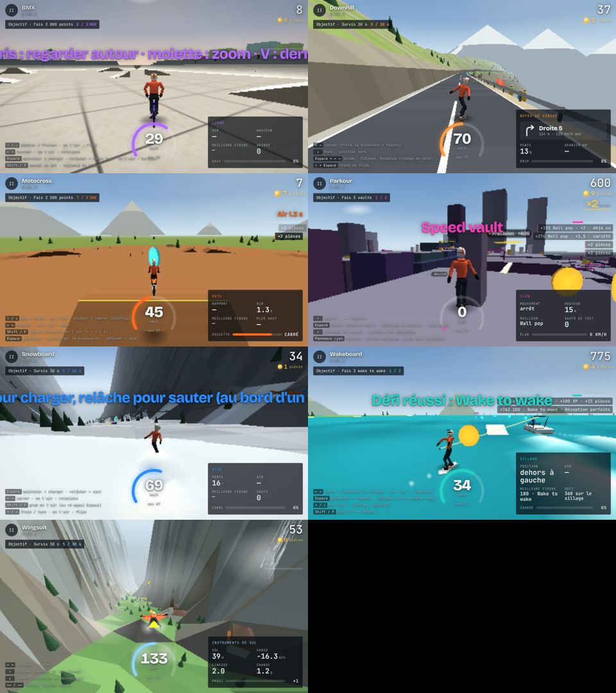

# Ligne Libre

<p align="center">
  
</p>

<p align="center">
  <a href="https://azert-maker.github.io/lignelibre.github/">
    
  </a>
  
  
  
  
</p>

<p align="center">
  <strong>Browser-based 3D extreme sports arcade</strong> · 7 sports · 7 locations · one-file web build
</p>

Ligne Libre is a browser-based 3D arcade sports game built around fast action, expressive movement, and a strong sense of replayability. It brings together multiple extreme sports disciplines in a single playable experience, designed to feel immediate, accessible, and fun from the very first run.

## Play now

- Live demo: https://azert-maker.github.io/lignelibre.github/
- Works in modern browsers
- Desktop and mobile friendly
- Internet required on first load to fetch assets

## Why it stands out

- 7 sports with distinct mechanics and rhythm
- 7 handcrafted locations with their own identity
- coins, progression, upgrade loop, and cosmetic rewards
- physics-based landings, reactions, and crash moments
- replay system, ghost tracking, and score-based runs
- a compact, portable project architecture that is easy to run and expand

## Featured sports

| Sport | Setting | Hook |
|---|---|---|
| Wingsuit | Alpine valley | glide lines, close-to-ground flying, ring runs |
| Downhill longboard | Coastal mountain road | speed, slides, edge control |
| Snowboard | Mountain resort | jumps, rails, rotations |
| BMX | Urban park | balance, tricks, grinds |
| Motocross | Off-road terrain | boosts, landings, whip control |
| Wakeboard | Lake course | traction, pop, wake-to-wake flow |
| Parkour | Rooftop city | chaining moves and wall runs |

## Quick start

### Run the game online

```text
https://azert-maker.github.io/lignelibre.github/
